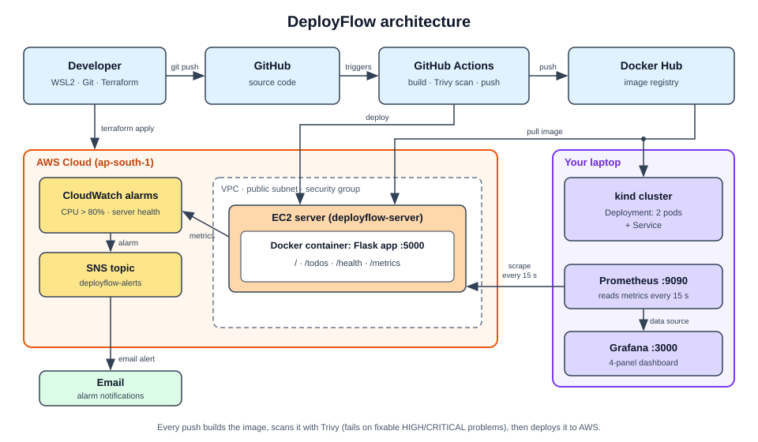

# DeployFlow 🚀

A complete DevOps pipeline project: a containerized Python Flask API, deployed on AWS
with Infrastructure as Code, automated CI/CD, and full monitoring.

## 📋 What This Project Does

A simple task-management API — taken through the **entire DevOps lifecycle**:
local development → version control → cloud infrastructure → automated CI/CD → monitoring.

The app is small on purpose. The power is in the **pipeline around it** — exactly how
real companies ship software.

## 🏗️ Architecture



## 🛠️ Tech Stack

| Area | Tools |
|---|---|
| App | Python, Flask |
| Containers | Docker, Docker Hub (image registry) |
| Cloud | AWS (EC2, VPC, CloudWatch, SNS) |
| Infrastructure as Code | Terraform (VPC, subnet, internet gateway, security group, SSH key, EC2) |
| CI/CD | GitHub Actions |
| Security | Trivy (fails the pipeline on fixable HIGH and CRITICAL image problems), .dockerignore |
| Monitoring | Prometheus, Grafana, CloudWatch alarms (email alerts via SNS) |
| Orchestration | Kubernetes (kind, local) |

## 📁 Project Structure

```
DeployFlow/
├── app.py              # Flask API (routes: /, /todos, /health, /metrics)
├── requirements.txt    # Pinned Python dependencies
├── Dockerfile          # Image build recipe (removes setuptools/wheel, upgrades apt)
├── .dockerignore       # Keeps keys, Terraform and Git files out of the image
├── README.md           # You are here
├── main.tf             # (Phase 3) AWS infrastructure as code (Terraform)
├── .github/workflows/  # (Phase 4) CI/CD pipeline
├── monitoring/         # (Phase 5) Prometheus config
└── k8s/                # (Phase 6) Kubernetes deployment and service
```

## 🚀 Quick Start (Local)

```bash
# 1. Build the image
docker build -t deployflow:v1 .

# 2. Run the container
docker run -d -p 5000:5000 --name deployflow deployflow:v1

# 3. Test it
curl http://localhost:5000/health
# → {"status":"ok"}

curl -X POST http://localhost:5000/todos \
  -H "Content-Type: application/json" \
  -d '{"task":"learn docker"}'

curl http://localhost:5000/todos
# → ["learn docker"]
```

Stop and clean up:

```bash
docker stop deployflow && docker rm deployflow
```

## 🔭 Monitoring

- **Prometheus** reads the app's `/metrics` page every 15 seconds. The config is in `monitoring/prometheus.yml`. The target IP in that file must be changed if the server gets a new IP.
- **Grafana** (port 3000) uses Prometheus (port 9090) as its data source. The dashboard has four panels:
  - All pages traffic: `app_requests_total`
  - Todos visits: `app_requests_total{endpoint="/todos"}`
  - Visits per minute: `rate(app_requests_total{endpoint!="/metrics"}[1m]) * 60`
  - App up (1 = yes, 0 = no): `up{job="deployflow"}`
- **CloudWatch alarms** (email through SNS): `deployflow-high-cpu` (CPU above 80% for 5 minutes) and `deployflow-instance-down` (server health check failing for 2 minutes).
- CloudWatch watches the **server**. Only Prometheus notices when the **app** stops while the server is still on.
- The Grafana dashboard is saved as `monitoring/grafana-dashboard.json` (in Grafana: Dashboards, New, Import)

## ☸️ Run on Kubernetes (local)

```bash
kind create cluster --name deployflow
kubectl apply -f k8s/
kubectl get pods
kubectl port-forward service/deployflow 8080:80
curl http://localhost:8080/health
```

The Deployment runs 2 pods. Delete one with `kubectl delete pod <name>` and the Deployment starts a new one.

## 🗺️ Roadmap (Phases)

- [x] **Phase 1** — Containerize Flask API with Docker
- [x] **Phase 2** — Version control with Git/GitHub
- [x] **Phase 3** — AWS infrastructure with Terraform (VPC, EC2, security group, SSH key)
- [x] **Phase 3b** — Manual deployment: app live on EC2 via Docker
- [x] **Phase 4** — CI/CD pipeline with GitHub Actions (auto build + Trivy scan + deploy on every push)
- [x] **Phase 5** — Monitoring: CloudWatch alarms + Prometheus/Grafana dashboards
- [x] **Phase 6** — Kubernetes deployment (kind)
- [x] **Phase 7** — Cost review & documentation (full AWS teardown planned before the Free plan ends on 2027-01-09)

## 💡 Key DevOps Practices Demonstrated

- **Immutable infrastructure** — app ships as a container image, not manual installs
- **Pinned dependencies** — direct libraries (Flask, prometheus-client) are version-locked in `requirements.txt`; their own sub-dependencies are not pinned yet
- **Multi-layer Docker builds** — dependency caching for fast rebuilds
- **Infrastructure as Code** — network, EC2 server and SSH key defined in Terraform (CloudWatch alarms and the SNS topic were created with AWS CLI commands, not yet in code)
- **Pipeline as Code** — CI/CD defined in YAML, versioned alongside the app
- **Security scanning** — Trivy scans every image before deploy and fails the pipeline on fixable HIGH and CRITICAL problems; `.dockerignore` keeps keys and Terraform files out of the image
- **Observability** — Prometheus and Grafana dashboard (traffic, visits per minute, app up/down) plus CloudWatch alarms with email alerts; both alarms were tested
- **Self-healing and scaling** — Kubernetes Deployment (2 pods) and Service on a local kind cluster; tested deleting pods and scaling up and down
- **Cost awareness** — unused EC2 servers are stopped when not needed

## 👤 Author

**Dakshina** — Aspiring DevOps Engineer


---
*Built as a hands-on learning project covering the full DevOps lifecycle.*
